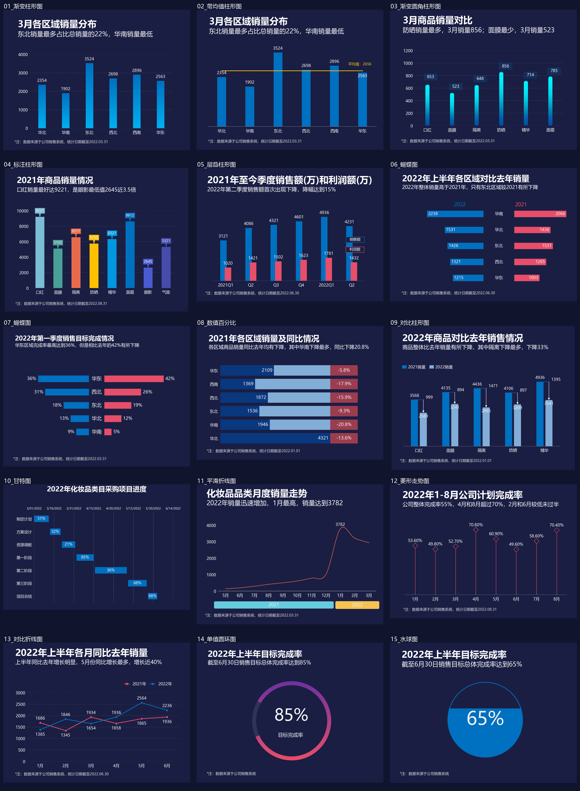
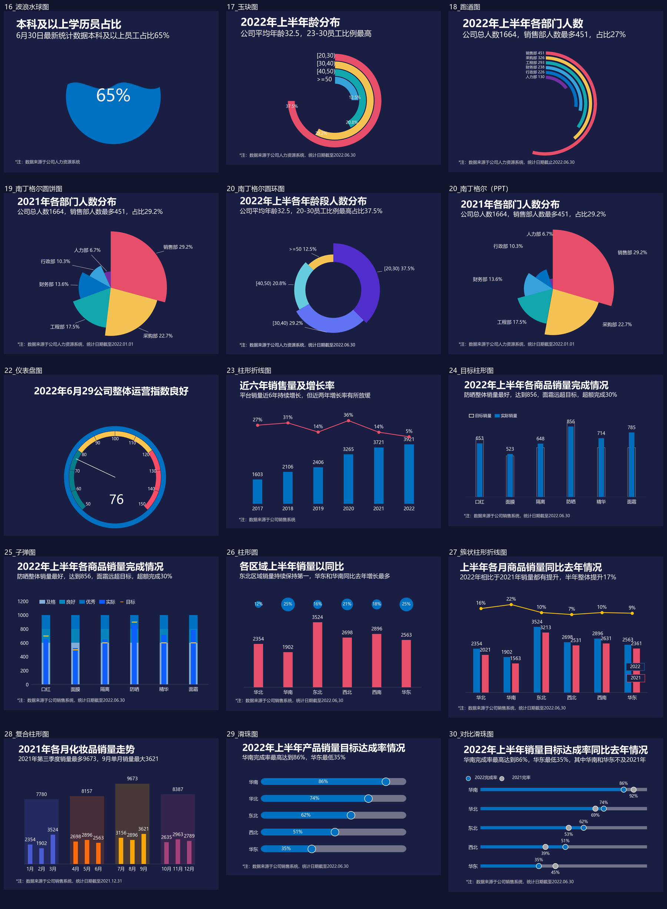
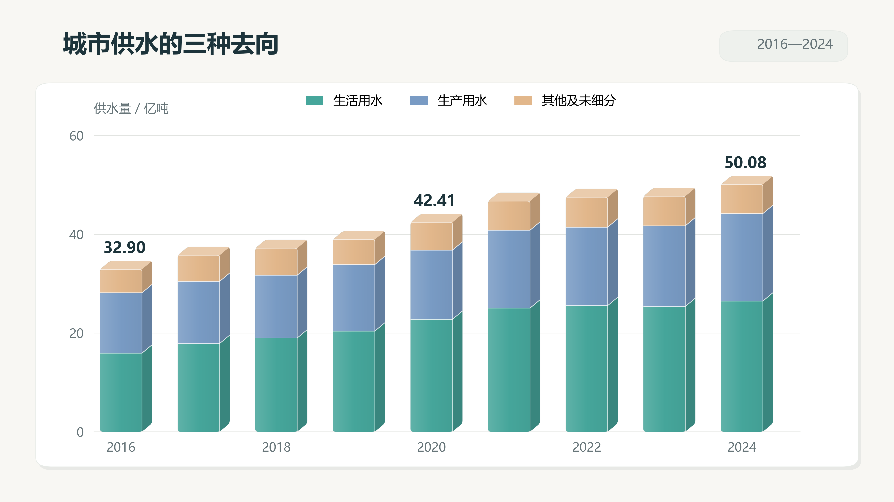
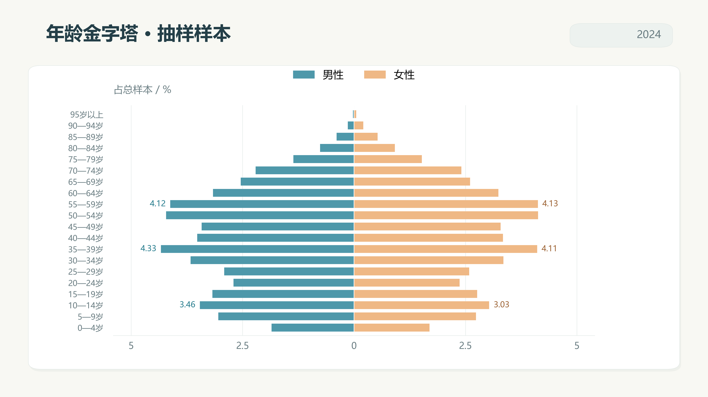

# Excel 数据可视化的 Python 复现与实践

基于郭宏远《Excel数据可视化——从图表到数据大屏》的学习实践，使用 Python 复现静态图表、动态图表与数据看板，并结合国家统计局数据开展城市与人口可视化分析。

仓库包含原始 Excel、Python 源码、Jupyter Notebook、图表图片和交互页面。

## 项目内容

| 模块 | 内容 | 成果形式 |
|---|---|---|
| 第二章：前15图 | 柱形图、折线图、甘特图、圆环图等 | PNG、SVG、Python |
| 第二章：后15图 | 南丁格尔图、跑道图、仪表盘、子弹图及组合图等 | PNG、Python |
| 第三章：动态图表 | 七类图表，支持月份、周期、部门和指标切换 | HTML、Streamlit、Notebook |
| 第四章：数据看板 | 销售与人力资源分析，支持筛选与联动展示 | HTML、Streamlit、Notebook |
| 浙江省城市概况 | 公共交通、供水燃气、绿地与城市设施 | 静态图、交互大屏、三维页面 |
| 全国人口 | 人口变化、年龄性别、城乡结构与普查画像 | 静态图、交互大屏、三维页面 |

## 部分成果展示

### 第二章：前15图



### 第二章：后15图



### 第四章：交互看板


### 国家统计局：浙江省城市概况



### 国家统计局：全国人口



## 目录结构

```text
.
├── 原文件/                     # 课程原始 Excel
├── 第二章图表Python复现/        # 前15图源码与成果
├── 第二章后15图Python复现/      # 后15图源码与成果
├── 第三章可视化/
│   ├── 网页版/
│   └── Streamlit版/
├── 第四章可视化/
│   ├── 网页版/
│   └── Streamlit版/
└── 国家统计局数据可视化/
    ├── 浙江省城市概况/          # 原始数据、图表、页面与源码
    └── 全国人口/
```

## 使用方法

下载并解压仓库，保留目录结构。PNG、SVG 可直接查看；HTML 下载后可用浏览器打开。GitHub 文件页不直接运行 HTML 或 Streamlit 应用。

### Streamlit 应用

建议使用 Python 3.10 或以上版本。以下两组命令分别在仓库根目录执行。

**第三章动态图表：**

```bash
python -m pip install -r "第三章可视化/Streamlit版/requirements.txt"
python -m streamlit run "第三章可视化/Streamlit版/app.py"
```

**第四章销售与人力资源看板：**

```bash
python -m pip install streamlit plotly openpyxl
python -m streamlit run "第四章可视化/Streamlit版/app.py"
```

打开终端显示的本地网址，结束时按 `Ctrl+C` 停止服务。请保留 Excel 数据文件：第三章读取同目录的工作簿，第四章读取“原文件”目录，也可在侧栏指定数据位置。

### Jupyter Notebook

- 第三章的 `第三章可视化.ipynb` 可依次运行并显示七图；末尾提供可选的 Streamlit 启动与停止代码。
- 第四章的 `Jupyter启动看板.ipynb` 用于启动看板，运行前将其中的 `folder` 改为本机对应目录。

### 国家统计局专题复现

两个专题各包含 10 张静态图、2 个交互大屏和 1 个三维页面。在仓库根目录执行：

```bash
python -m pip install "matplotlib>=3.8" "plotly>=5.24" numpy pillow openpyxl
python "国家统计局数据可视化/浙江省城市概况/可视化/python/regenerate_all.py"
python "国家统计局数据可视化/全国人口/可视化/python/regenerate_all.py"
```

生成器默认使用内嵌数据快照，可通过 `--help` 查看参数。绘制中文图表需安装微软雅黑、黑体或 Noto Sans SC 等中文字体。

## 技术与资料

**技术栈：** Python、Matplotlib、Plotly、Streamlit、pandas、NumPy、OpenPyXL、Jupyter。

**参考资料：** 郭宏远《Excel数据可视化——从图表到数据大屏》；国家统计局公开统计数据。

本项目用于课程学习与代码实践。图表保留原始数据的主要口径，部分配色、布局与交互做了调整；具体计算说明见源码及交互页面。原始课程资料的权利归其权利人所有。
